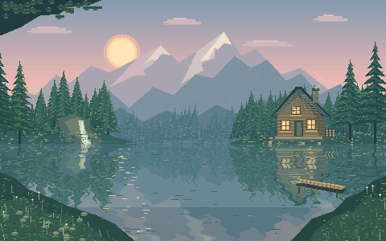

# Pixel Hideaway

A quiet little place to escape to. A cabin, a mountain lake, moving water, chimney smoke, wildflowers, and fireflies, drawn in pixel art.



## Enjoy the scene

Open `index.html` in a browser. It runs completely offline, with no installation, external assets, accounts, tracking, or network requests. Use **Sound off** to enable the gentle ambient music. Sound starts only when requested.

The scene uses native Canvas drawing and locally synthesized audio. It respects the browser's reduced-motion preference. The included GIF is a silent, endlessly looping 12-second animation at 480 × 300 pixels.

## Export the GIF

The animation itself has no dependencies. Rebuilding the GIF requires Node.js 20 or later, Playwright's Chromium browser, and FFmpeg on your PATH.

```sh
npm ci
npx playwright install chromium
npm run check:preview
npm run export:gif
```

The exporter checks browser rendering, the sound toggle, and a narrow viewport, then writes `output/pixel-hideaway.gif`. For an existing Chromium installation, set `PLAYWRIGHT_CHROMIUM_EXECUTABLE` to its executable path.
